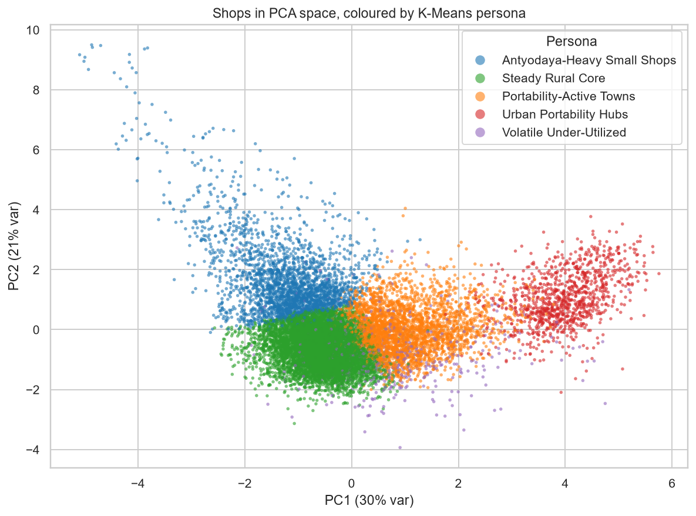

# Telangana PDS Analytics: Multi-Dimensional Shop Performance Clustering and Anomaly Profiling

Clustering **17,491 Fair Price Shops** in Telangana by behaviour, and flagging shops that deviate from their
peers (possible ghost beneficiaries or stock diversion), using 29 months of open government data
(Jan 2023 to May 2025, ~500k shop-month records).

**Stack:** Python · Pandas · Scikit-Learn (StandardScaler, PCA, K-Means, DBSCAN) · Matplotlib/Seaborn · Plotly ·
Folium · Streamlit · MySQL



## Business questions and answers

| Use case | Finding |
|---|---|
| **Policy impact (ONORC)** | Portability rose from 34.4% of all transactions in 2023 to 37.5% in 2025. Urban shops: 65% → 68%. Rural: 26% → 29%. 11% of urban "Portability-Active Towns" became "Urban Portability Hubs" within a year. |
| **Fraud prevention** | 1,422 shop-years (2.7%) flagged by DBSCAN noise or peer-deviation z-score > 3.5. "Volatile Under-Utilized" shops are 3.7% of shops but have a 20% flag rate. |
| **Logistics** | 2,297 portability-hub shop-years, 60% of them in the 3 metro districts and spread over only 109 of 585 circle offices. These are the candidates for fortnightly restocking. |

## The five shop personas (K-Means, k = 5)

| Persona | Share | Defining traits |
|---|---|---|
| Steady Rural Core | 51% | average size, 13% portability, very stable |
| Portability-Active Towns | 21% | 60% of transactions from other shops' cards |
| Antyodaya-Heavy Small Shops | 17% | small, highest share of poorest (AAY) cards, most rice per transaction |
| Urban Portability Hubs | 7% | 100% Hyderabad metro, largest shops, 78% portability, the only wheat users |
| Volatile Under-Utilized | 4% | erratic volumes, 54% card utilization → audit priority |

## Project structure

```
├── app.py                       Streamlit dashboard
├── notebooks/
│   └── PDS_Shop_Clustering_Analysis.ipynb   EDA + modelling, explained step by step
├── src/
│   ├── config.py                paths and settings
│   ├── download_data.py         step 1: fetch CSVs from the Telangana Open Data Portal API
│   ├── data_prep.py             step 2: stack monthly files + triple join -> master table
│   ├── features.py              step 3: shop-year behaviour features
│   ├── modeling.py              step 4: scaling, PCA, K-Means, DBSCAN, peer z-scores, persona naming
│   ├── run_pipeline.py          runs steps 2-4 and writes data/processed/
│   ├── db.py                    data access layer: every dashboard filter is a parameterised SQL query
│   └── load_to_mysql.py         load the star schema into MySQL
├── sql/
│   ├── 01_schema.sql            star schema (dim_shop, fact_shop_month, shop_year_clusters, cluster_profiles)
│   └── 02_analysis_queries.sql  business questions in SQL for MySQL Workbench
├── data/
│   ├── raw/                     downloaded CSVs (git-ignored)
│   └── processed/               model outputs (CSV kept, parquet git-ignored)
└── reports/
    ├── Final_Report.md          insights and recommendations
    ├── hotspot_map.html         Folium anomaly + hub map
    └── figures/                 all charts from the notebook
```

## How to run (VS Code, Windows)

The virtual environment lives at `D:\venvs\telangana_pds`, because this folder's path is long enough to hit
Windows' 260-character path limit during `pip install`. `.vscode/settings.json` already points VS Code to it.

```bash
# one-time setup (already done on this PC)
python -m venv D:\venvs\telangana_pds
D:\venvs\telangana_pds\Scripts\activate
pip install -r requirements.txt

# 1. download data (~100 MB)  2. build features + models  3. open the dashboard
python src/download_data.py
python src/run_pipeline.py
streamlit run app.py
```

In VS Code you can also use **Run and Debug** (Ctrl+Shift+D) → *Run pipeline* / *Streamlit dashboard* /
*Load into MySQL*. Open the notebook and pick the kernel **Python (telangana_pds)**.

### MySQL / Workbench

1. Copy `.env.example` to `.env` and put in your MySQL root password.
2. `python src/load_to_mysql.py` creates the `telangana_pds` schema and loads about 570k rows.
3. In MySQL Workbench, open `sql/02_analysis_queries.sql` and run the queries (Ctrl+Enter).
4. Restart the dashboard. The sidebar should say **Data source: MySQL · telangana_pds**.

### How the dashboard gets its data

```
Sidebar filters ──► src/db.py builds a parameterised SQL query ──► database
                                                                     │  WHERE / JOIN / GROUP BY
Charts ◄── only the matching rows (or pre-summed totals) ◄───────────┘
```

* **Filtering happens in the database**, not in pandas. Year, District, Persona and "Only flagged
  anomalies" become `WHERE` clauses. Monthly trends are summed with `GROUP BY` inside the database
  (~500k fact rows in, ~60 rows out), so the app never loads the full fact table into memory.
* **Parameterised queries**: filter values are sent separately from the SQL text (`distName IN :districts`),
  so they can't be used for SQL injection. Column names, which can't be parameters, go through an allow-list.
* **Indexes** on `(year, persona)` and `(year, anomaly_flag)` match the dashboard's filter order.
* **"🔍 SQL behind this view"** in the sidebar shows the exact query and parameters for the current filters.
* **Fallback**: if MySQL isn't reachable (no `.env`, service stopped, tables not loaded), the app builds
  `data/processed/pds_local.sqlite` from the parquet files and runs the *same SQL* there. The sidebar shows
  which source is in use. Set `PDS_DB_BACKEND=mysql` in `.env` to disable the fallback.

## Method summary

1. **Integration:** 60 monthly CSVs stacked with `pd.concat`, left-joined on `(distCode, shopNo, year, month)`
   and `(distCode, shopNo)` with `validate=` checks. Out-of-state coordinates are blanked.
2. **Features (shop-year):** utilization ratio, portability share, rice per transaction, wheat share,
   Antyodaya share, monthly volatility (CV), and log shop size. All are ratios, so size doesn't dominate.
3. **Scaling:** extreme 0.1% clipped, then `StandardScaler`.
4. **PCA:** 3 components explain 70% of the variance (urban-hub axis, poverty axis, irregularity axis).
5. **K-Means:** k = 5 chosen with the elbow curve and silhouette (best silhouette in the 4-5 range = 0.25).
6. **DBSCAN** on PCA space (`min_samples` = 6, `eps` from the k-distance knee): 621 noise shop-years.
7. **Peer deviation:** robust z-score (median/MAD) of utilization and rice per transaction *within each persona*.
8. **Evaluation:** silhouette, elbow, purity vs Urban/Rural (94%, and the Urban Hub persona is 100% urban even
   though area type was never a feature), persona stability between years (85-98% on the diagonal).

## Data source

Telangana Open Data Portal, Civil Supplies Department:
*FP Shop Wise Transactions*, *Fair Price Shop Card Status*, *Fair Price Shop Status Latitude and Longitude*
(https://data.telangana.gov.in).

> Anomaly flags are statistical leads for field verification, not evidence of wrongdoing.
